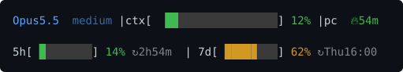

# claude-mod-statusline

A Claude Code mod that draws a two-line usage status under the prompt:



- **Line 1:** model, reasoning effort, context window fill, prompt cache time left (🔥, yellow under 5 min, ❄ cold once expired)
- **Line 2:** 5 hour and 7 day limits with time to reset (only with a Claude subscription login)

Bars turn yellow and red as they fill. The context bar stretches so both lines are equally wide.

## Install

```
/plugin install usage-bars --marketplace Mariator-pro/claude-mod-statusline
```

Answer `y` to add the marketplace, then pick a scope. Needs a Claude Code version with mod support. If `statusLine` is set in `~/.claude/settings.json` (on Windows `%USERPROFILE%\.claude\settings.json`), remove it, or both show.

## Develop

Run from a working copy (reloads on save):

```
claude --plugin-dir <path-to-clone>
```

Or for every session, in `~/.claude/settings.json`:

```json
"env": { "CLAUDE_CODE_PLUGIN_DIRS": "/absolute/path/to/claude-mod-statusline" }
```

Check and test:

```
claude plugin validate .
claude plugin test .
```
